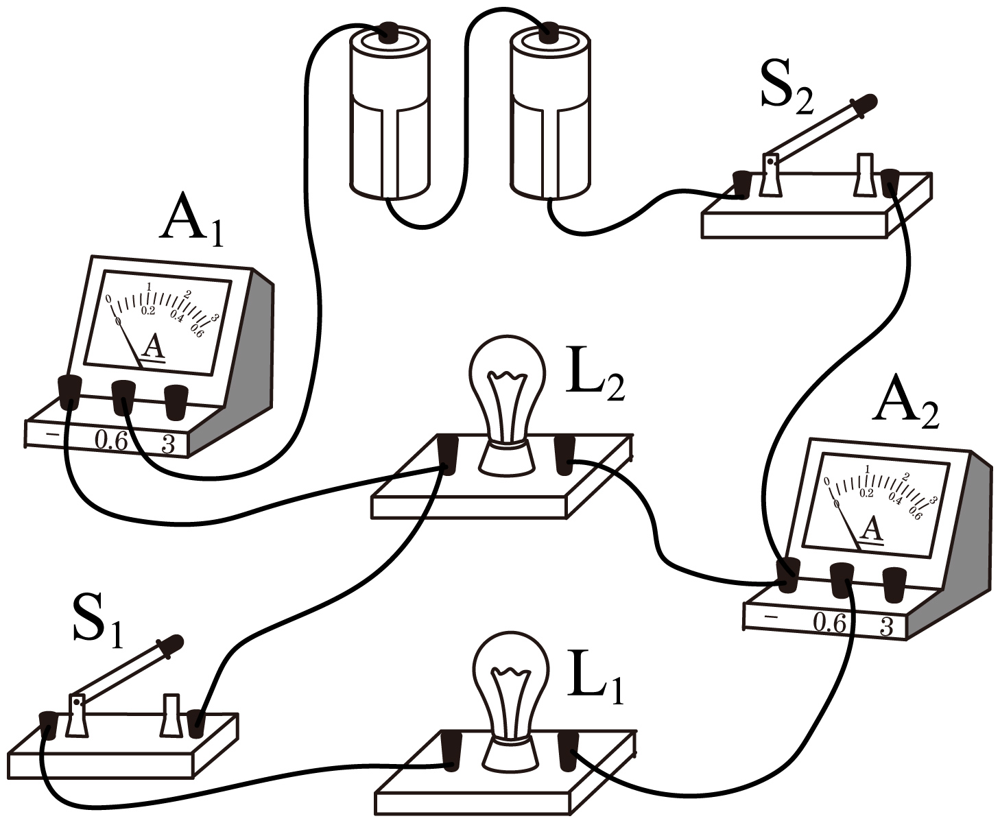

# Physics - 题目 2792

**ID**: f60a2cc6b003441fa85dfa7adf671580
**年级**: Grade 9
**难度**: Medium
**题型**: Multiple-choice

## 题目
如图所示电路，闭合开关S_{1}、S_{2}，小灯泡L_{1}和L_{2}均正常发光，两电表都有示数，下列判断正确的是（      ）​​​​​​​‌

## 解答

1. 由图可知，闭合开关S_{1}、S_{2}时，L_{1}、L_{2}并联，电流表A_{1}在干路上，电流表A_{2}串联在L_{1}的支路中。
2. A．仅断开S_{1}，灯L_{1}和电流表A_{2}所在支路断路，则电流表A_{2}示数为0，此时电流表A_{1}测通过L_{2}的电流，其示数不为零，所以只有一个表有示数，故A正确；
3. B．由图知道，电流表A_{1}测干路中的电流，电流表A_{2}测通过L_{1}的电流，由并联电路的电流特点知道，A_{1}的示数大于A_{2}的示数，故B错误；
4. C．L_{1}、L_{2}并联，当灯L_{1}被短路时，L_{2}也被短路，则L_{2}不能发光，故C错误；
5. D．电流表A_{1}在干路上，测干路中的电流，即测量两盏灯的总电流，故D错误。

## 知识点

**中文**:
  - 串、并联电路中短路和断路的分析
  - 电流表的使用
  - 并联电路的电流规律

**English**:
  - Analysis of Short and Open Circuits
  - Using an Ammeter
  - Current Law in Parallel Circuits

---
