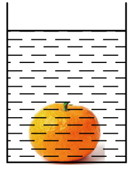

# Physics - 题目 2522

**ID**: f8791b956fc94a26ae927bbea1151d62
**年级**: Grade 9
**难度**: Medium
**题型**: Multiple-choice

## 题目
如图所示，小红发现将一个不带皮的砂糖橘放入水中后，砂糖橘在水中下沉，最终静止在杯底。​​​​​​​‌则不带皮的砂糖橘（      ）

## 解答

1. A．砂糖橘在水中下沉，根据物体的沉浮条件可知，砂糖橘的密度小于水的密度，故A不符合题意；
2. B．砂糖橘在水中逐渐下沉的过程中，排开水的体积不变，水的密度不变，根据F_{浮​}=ρ_{液}​gV_{排}​可知，浮力不变，故B不符合题意；
3. C．沉到杯底处于静止状态时，受到竖直向上的浮力、支持力，以及竖直向下的重力，故C不符合题意；
4. D．砂糖橘在水中下沉，根据物体的沉浮条件可知，砂糖橘受到的浮力小于其重力；沉底时，浮力等于重力减去支持力，则浮力小于重力，故D符合题意。

## 知识点

**中文**:
  - 物体的浮沉条件及其应用
  - 阿基米德原理的应用

**English**:
  - Floating/Sinking Conditions and Applications
  - Applications of Archimedes' Principle

---
