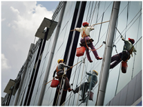

# Physics - 题目 575

**ID**: f97895b954b948538406fdd609eb01b5
**年级**: Grade 9
**难度**: Medium
**题型**: Multiple-choice

## 题目
如图是工人高空作业的情景，玻璃幕墙相当于平面镜。​​​​​​​‌下列说法正确的是（      ）

## 解答

1. A．平面镜所成的像是虚像，故A错误；
2. B．平面镜成像中像和物的大小相同，所以工人远离玻璃幕墙时，镜中的像大小不变，故B错误；
3. C．工人工作时佩戴防滑手套是通过增大接触面粗糙程度来增大摩擦，故C错误；
4. D．平面镜成像中像和物到平面镜的距离相等，所以工人距玻璃幕墙0.5m时，他在镜中的像也距玻璃幕墙0.5m，故D正确。
5. 故选D。

## 知识点

**中文**:
  - 平面镜成像的特点、原理及现象

**English**:
  - Characteristics, Principles, and Phenomena

---
