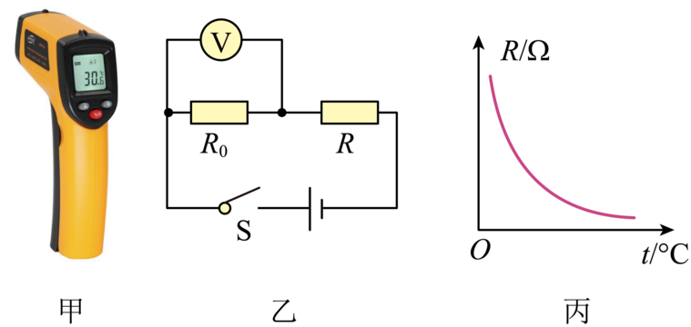

# Physics - 题目 1384

**ID**: fca53e2122ef4040a8444d3b12e8eeb8
**年级**: Grade 9
**难度**: Medium
**题型**: Multiple-choice

## 题目
疫情防控期间，各大公共场所常常用到图甲所示的测温枪测量体温，图乙是它的工作原理图，R_{0}是定值电阻，R是红外线热敏电阻，其阻值随人体温度变化的图象如图丙。​​​​​​​‌对该电路分析错误的是（      ）

## 解答

1. A．两电阻串联，电压表测定值电阻的电压，体温越高，由图丙知，红外线热敏电阻越小，故A正确，不符合题意；
2. B．根据 $I=\frac {U}{R}$ 知，在电源电压不变时，电路的电流越大，故B正确，不符合题意；
3. C．由分压原理知，当热敏电阻减小时，热敏电阻的电压越小，根据串联电路电压的规律，电压表示数越大，故C错误，符合题意；
4. D．由B知体温越高，电路中的电流越大，根据 $R=\frac {U}{I}$ 知电路的总电阻越小，故D正确，不符合题意。

## 知识点

**中文**:
  - 动态电路中电表示数的变化

**English**:
  - Changes in Meter Readings in Dynamic Circuits

---
