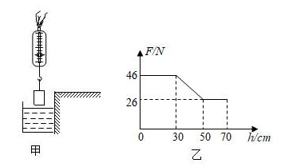

# Physics - 题目 1841

**ID**: 27680dcf274d4df7ada4a4e8366f1498
**年级**: Grade 9
**难度**: Medium
**题型**: Multiple-select

## 题目
如图甲所示，某科技小组的同学用弹簧测力计悬挂一实心圆柱形金属块，使其缓慢匀速下降，并将其浸入平静的游泳池水中，弹簧测力计的示数F与金属块下表面下降高度h的变化关系如图乙所示，忽略金属块漫入水中时池水液面高度的变化，已知池水的密度为1.​​​​​​​‌0×10^{3}kg/m^{3}，g取10N/kg，则下列说法中正确的是（      ）

## 解答

1. 由图像可知，当h=0时，弹簧测力计示数为46N，此时金属块处于空气中，根据二力平衡条件可知，金属块的重力为
2. $G=F{{}_{拉}}=46{\rm{N}}$
3. 金属块的质量为
4. $m=\frac {G}{g}=\frac {46{\rm{N}}}{10{\rm{N}}{\rm{/}}{\rm{k}}{\rm{g}}}=4.6{\rm{k}}{\rm{g}}$
5. 由图像可知，当h=50cm之后，弹簧测力计示数不变，金属块浸没水中，受到的浮力为
6. $F{{}_{浮}}=G-F^{′}{{{}_{拉}}}=46{\rm{N}}-26{\rm{N}}=20{\rm{N}}$
7. 由 $F{{}_{浮}}=ρ{{}_{液}}gV{{}_{排}}$ 可得，金属块体积为
8. $V=V{{}_{排}}=\frac {F{{}_{浮}}}{ρ{{}_{水}}g}=\frac {20{\rm{N}}}{1\times 10{^{3}}{\rm{k}}{\rm{g}}{\rm{/}}{\rm{m}}{^{{\rm{3}}}}\times 10{\rm{N}}{\rm{/}}{\rm{k}}{\rm{g}}}=2\times 10{^{-3}}{\rm{m}}{^{{\rm{3}}}}$
9. 金属块的密度为
10. $ρ=\frac {m}{V}=\frac {4.6{\rm{k}}{\rm{g}}}{2\times 10{^{-3}}{\rm{m}}{^{{\rm{3}}}}}=2.3\times 10{^{3}}{\rm{k}}{\rm{g}}{\rm{/}}{\rm{m}}{^{{\rm{3}}}}$
11. 金属块刚浸没时下表面距水面距离为
12. $h=50{\rm{c}}{\rm{m}}-30{\rm{c}}{\rm{m}}=20{\rm{c}}{\rm{m}}=0.2{\rm{m}}$
13. 金属块下底面受到水的压强为
14. $p=ρ{{}_{水}}gh=1\times 10{^{3}}{\rm{k}}{\rm{g}}{\rm{/}}{\rm{m}}{^{{\rm{3}}}}\times 10{\rm{N}}{\rm{/}}{\rm{k}}{\rm{g}}\times 0.2{\rm{m}}=2\times 10{^{3}}{\rm{P}}{\rm{a}}$
15. 故选AB。

## 知识点

**中文**:
  - 密度、压强和浮力的综合

**English**:
  - Integrated Density, Pressure, and Buoyancy

---
