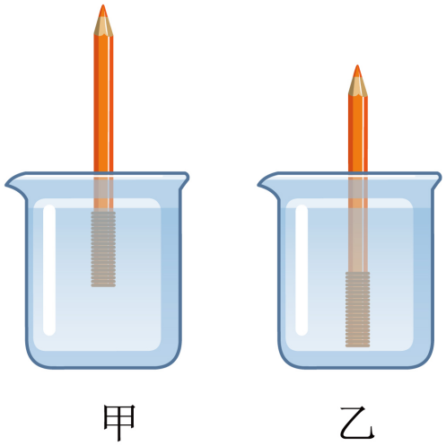

# Physics - 题目 2813

**ID**: 3864d3abe3f742c3b2f6a064c42ba704
**年级**: Grade 9
**难度**: Medium
**题型**: Multiple-select

## 题目
某同学用铅笔、细铁丝制作了一支简易密度计，他将密度计先后插入盛有不同液体的甲、乙两个相同容器中。​​​​​​​‌当密度计静止时，两容器中液面恰好相平，如图所示。下列说法正确的是（      ）

## 解答

1. AC．密度计在液体里都处于漂浮，则它受到的浮力等于自身重力，即浮力大小相等。甲排开液体的体积小于乙排开液体的体积，根据阿基米德原理F_{浮}=ρ_{液}gV_{排}可知，液体的密度ρ_{甲}>ρ_{乙}，故A正确，C错误；
2. B．由图可知，甲中液体的体积大于乙液体的体积，且密度ρ_{甲}>ρ_{乙}，根据G=ρVg可知，液体重力G_{甲}>G_{乙}。根据容器对水平桌面的压力F=G_{容器}+G_{液体}+G_{密度计}_{，}可知，甲容器对桌面的压力更大，故B错误；
3. D．密度计插入前后，容器底部增大的压力都等于密度计的重力，即压力的增大量相等。根据 ${\rm{Δ}}p=\frac {{\rm{Δ}}F}{S}$ 可知，容器底部受到液体的压强变化量相等，故D正确。

## 知识点

**中文**:
  - 密度、压强和浮力的综合

**English**:
  - Integrated Density, Pressure, and Buoyancy

---
