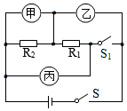

# Physics - 题目 1121

**ID**: 6689c623011049ee9eb7f5ffe3cb9ec9
**年级**: Grade 9
**难度**: Medium
**题型**: Multiple-select

## 题目
在如图所示的电路中，开关S闭合后下列所列的各种情况中正确的是（      ）​​​​​​​‌

## 解答

1. A．电路中甲表和乙表可以同时是电流表，电流表相当于导线，开关S闭合后，电源短路，A错误；
2. B．如甲、乙、丙是电压表，当S_{1}闭合后，该电路为串联电路，甲测量的是R_{2}两端的电压，乙测量的是R_{1}两端的电压，丙测量的是电源两端的电压，根据串联电路的电压关系可知U_{丙}=U_{甲}+U_{乙}，B正确；
3. C．如甲是电压表，乙、丙电流表，S_{1}断开后，电流的路径有两条，形成并联电路，C错误；
4. D．要使该电路为并联电路，则电流的路径有两条，甲是电压表，乙、丙电流表，乙测的是干路中的电流，丙测的是通过R_{1}的电流，根据并联电路电流特点可知，干路中的电流等于各支路电流之和，即乙表的示数大于丙表的示数，D正确。

## 知识点

**中文**:
  - 串联电路的电压规律
  - 电流表的使用
  - 并联电路的电流规律
  - 电压表的使用

**English**:
  - Voltage Law in Series Circuits
  - Using an Ammeter
  - Current Law in Parallel Circuits
  - Using a Voltmeter

---
