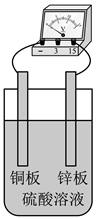

# Physics - 题目 2848

**ID**: a1361303ef1b4c3a88c2003a8963b939
**年级**: Grade 9
**难度**: Medium
**题型**: Multiple-select

## 题目
1800年，意大利科学家伏打在实验中发现，在一个装有硫酸溶液的烧杯中，把一个铜板和一个锌板作为电极插入硫酸溶液中，在铜板和锌板之间接入一个小灯泡，小灯泡发光。​​​​​​​‌此装置就是一个电池，叫做伏打电池。用电压表可以测出伏打电池的电压，如图所示。关于伏打电池，下列所提出的问题中属于正确的可探究科学问题的是（      ）

## 解答

1. A．可探究科学问题是可以通过实验收集信息并予以解答，并且课探究科学问题描述的是两个或多个变量之间的关系，其中的变量必须是可检验的。也就是说，可以探究的科学问题中的因变量和自变量都是可以观察或测量的。根据材料信息，伏打电池的材料是由铜和锌组成的，试想换种材料会影响其电压吗？故A符合题意；
2. B．根据可探究科学问题的研究对象，这个影响因素没有明确说明，导致变量不清晰，所以不得探究，故B不符合题意；
3. C．题目中没有明确说明电极间的距离是多少，或许距离不一样，电压也不同呢，是一个可以探究的变量，故C选项符合题意；
4. D．硫酸中存在自由移动的粒子，那离子的数量是不是会影响其电压大小呢，根据所以知识，这个是一个很好的探究性的问题，故D选项符合题意。
5. 故选ACD。

## 知识点

**中文**:
  - 电流的形成

**English**:
  - Formation of Electric Current

---
