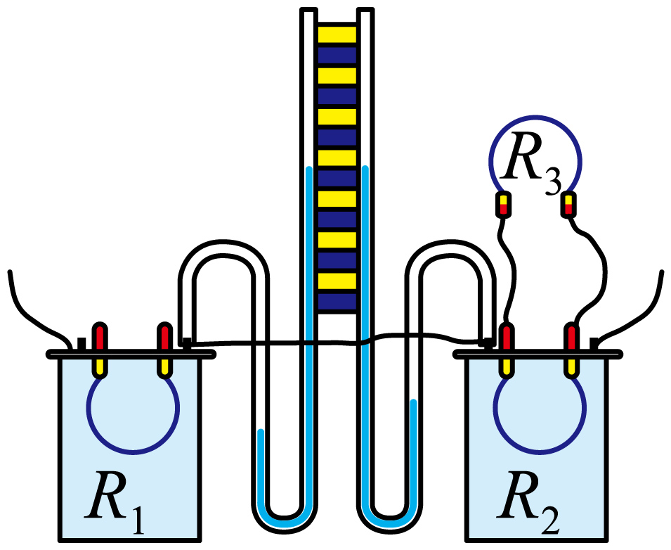

# Physics - 题目 622

**ID**: a92431baae034e2c8b698d690240d83b
**年级**: Grade 9
**难度**: Medium
**题型**: Multiple-select

## 题目
如图，已知三个电阻阻值均为5Ω，电路两端电压恒为 6V。​​​​​​​‌下列说法正确的有（      ）

## 解答

1. A．由题知，R_{1}=R_{2}=R_{3}，由图知，R_{2}与R_{3}并联后再与R_{1}串联，由串并电路电流特点知：I_{2}=I_{3}，I_{1}=I_{2}+I_{3}=2I_{2}，通电时间相等，可以探究通过导体产生热量与电流大小的关系，故A正确；
2. B．因为I_{1}=2I_{2}，且R_{1}=R_{2}，由Q=I2Rt可知，相同时间内R_{1}产生的热量是R_{2}的4倍，故B错误；
3. C．由串并电路的电阻特点可知，将R_{3}拆除前，电路总电阻 $R=R{{}_{1}}+\frac {R{{}_{2}}R{{}_{3}}}{R{{}_{2}}+R{{}_{3}}}={{5}}{\rm{Ω}}{{+}}\frac {{{5}}{\rm{Ω}}{\rm{×}}{{5}}{\rm{Ω}}}{{{5}}{\rm{Ω}}{{+}}{{5}}{\rm{Ω}}}{\rm{=}}{{7}}{{.}}{{5}}{\rm{Ω}}$ ，电路中电流 $I=I{{}_{1}}=2I{{}_{2}}=\frac {U}{R}=\frac {{{6}}{\rm{V}}}{{{7}}{{.}}{{5}}{\rm{Ω}}}{\rm{=}}{{0}}{{.}}{{8}}{\rm{A}}$ ，可得 $I{{}_{2}}={{0}}{{.}}{{4}}{\rm{A}}$ ，将R_{3}拆除后，R_{1}与R_{2}串联，电路中电流 $I{^{\prime }}=I{{}_{1}^{\prime }}=I{{}_{2}^{\prime }}=\frac {U}{R{{}_{1}}+R{{}_{2}}}=\frac {{{6}}{\rm{V}}}{{{5}}{\rm{Ω}}{{+}}{{5}}{\rm{Ω}}}{\rm{=}}{{0}}{{.}}{{6}}{\rm{A}}$ ，所以通过R_{1}的电流将减小，故C正确；
4. D．由P=I^{2}R可知，将R_{3}拆除后也拆除前R_{2}的电功率比： $\frac {P{{}_{2}^{\prime }}}{P{{}_{2}}}=\frac {I{{}_{2}^{\prime 2}}R{{}_{2}}}{I{{}_{2}^{2}}R{{}_{2}}}={\left({\frac {I{{}_{2}^{\prime }}}{I{{}_{2}}}}\right)^{2}}=\left ({\frac {{{0}}{{.}}{{6}}{\rm{A}}}{{{0}}{{.}}{{4}}{\rm{A}}}}\right ){^{{{2}}}}{\rm{=}}\frac {{{9}}}{{{4}}}$ ，即 $P{{}_{2}^{\prime }}=\frac {9}{4}P{{}_{2}}$ ，故D错误。

## 知识点

**中文**:
  - 影响电流热效应因素的探究实验

**English**:
  - Experiment: Factors Affecting Heating Effect

---
