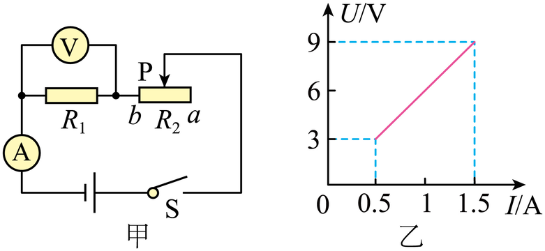

# Physics - 题目 1084

**ID**: b1e82ebc179344d5b691969cf94e9600
**年级**: Grade 9
**难度**: Medium
**题型**: Multiple-select

## 题目
如图甲所示的电路，电源电压保持不变。​​​​​​​‌闭合开关S，滑动变阻器的滑片P从a端滑到b端的整个过程中，电流表示数I与电压表示数U的关系图像如图乙所示。定值电阻R_{1}的最大功率为P_{1}，滑动变阻器的滑片P滑到a端时，滑动变阻器R_{2}的功率为P_{2}。下列说法正确的是（      ）

## 解答

1. AB．由图甲所示电路可知，电阻R_{1}与R_{2}串联，电压表测R_{1}两端的电压，滑动变阻器的滑片P从a端滑到b端；根据串联分压规律可知，图乙所示的电流表示数I与电压表示数U的关系图像与滑片P的a端、b端的对应关系为
2. 
3. 由题意可知，当滑片P位于b端时，只有R_{1}接入电路中，所以由上图可知，此时电压表示数为9V，即 $U{{}_{源}}=9{\rm{V}}$ ，且此时滑片P在b端时对应的电流为1.5A，则 $R{{}_{{{1}}}}=\frac {U{{}_{源}}}{I{{}_{{{1}}}}}=\frac {9{\rm{V}}}{1.5{\rm{A}}}=6{\rm{Ω}}$
4. 故A错误，B正确；
5. C．当滑片P滑至a端时，滑动变阻器R_{2}接入电路的阻值最大，且此时对应的电压表与电流表的示数分别为 $U{{}_{1}}{^{\prime }}=3{\rm{V}}，I^{′}=0.5{\rm{A}}$ ，因电阻R_{1}与R_{2}串联，根据串联电路的特点，滑动变阻器R_{2}两端电压为 $U{{}_{2}}=U{{}_{源}}-U{{}_{1}}{^{\prime }}=9{\rm{V}}-3{\rm{V}}=6{\rm{V}}$
6. 所以滑动变阻器R_{2}的最大阻值为 $R{{}_{2}}=\frac {U{{}_{2}}}{I^{′}}=\frac {6{\rm{V}}}{0.5{\rm{A}}}=12{\rm{Ω}}$
7. 故C错误；
8. D．由题意得，当滑片P滑至a端时，滑动变阻器R_{2}的功率为 $P{{}_{{{2}}}}=U{{}_{{{2}}}}I^{′}=6{\rm{V}}\times 0.5{\rm{A}}=3{\rm{W}}$
9. 当滑片P滑至b端时，只有R_{1}接入电路，由图乙可知，此时R_{1}两端电压 $U{{}_{1}}=U{{}_{源}}=9{\rm{V}}{\rm ，\mathit{R}_{1}}$ 中的电流 $I{{}_{1}}=1.5{\rm{A}}$ ，所以定值电阻R_{1}的最大功率为 $P{{}_{1}}=U{{}_{1}}I{{}_{1}}=9{\rm{V}}\times 1.5{\rm{A}}=13.5{\rm{W}}$
10. 则 $\frac {P{{}_{1}}}{P{{}_{2}}}=\frac {13{{.}}5{\rm{W}}}{3{\rm{W}}}=\frac {9}{2}$
11. 故D正确。

## 知识点

**中文**:
  - 与欧姆定律有关的动态电路计算

**English**:
  - Calculations in Dynamic Circuits using Ohm's Law

---
