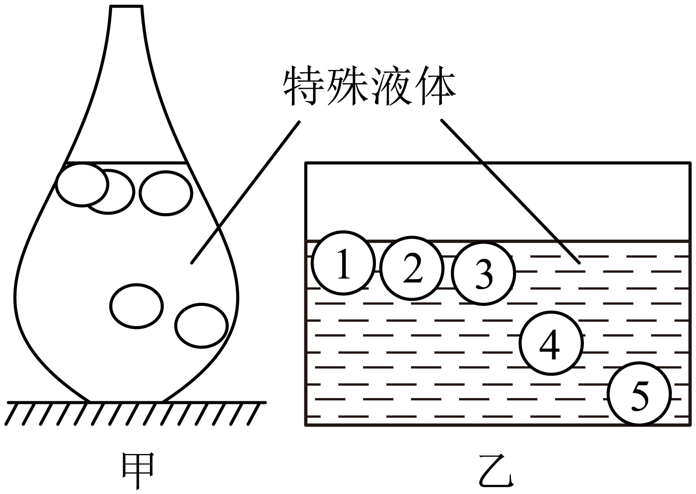

# Physics - 题目 500

**ID**: be78eb2759e744179c8b75b12d5f9ebf
**年级**: Grade 9
**难度**: Medium
**题型**: Multiple-select

## 题目
图甲为一彩球“温度计”，其密闭玻璃容器内装有一种特殊液体，随着温度升高，这种液体的密度会减小。​​​​​​​‌液体中有5个挂有温度标牌的彩球，彩球体积（包括标牌）相等，其热胀冷缩可以忽略。当有彩球悬浮时，悬浮的彩球标牌上的温度值就是所测得的当前环境温度。图乙为这个温度计的示意图，编号为4的彩球标牌所标温度值为22℃，相邻编号的彩球标牌上的温度值间隔为2℃。下列说法正确的是（      ）

## 解答

1. 当温度升高时，液体的密度变小，原来悬浮的小球因为浮力变小而沉底，彩球4号表示环境温度为22℃，彩球5号比4号先沉底，说明彩球5号表示的温度低于彩球4号表示的温度，所以彩球5号表示环境温度为20℃，那么彩球3号表示环境温度24℃，彩球2号表示环境温度为26℃，彩球1号表示28℃。
2. A．彩球4在22℃时悬浮，彩球4的密度等于液体的密度，浮力等于重力，在18℃时，温度低，液体的密度比较大，彩球4号处于漂浮状态，浮力等于重力，彩球所受的浮力相同，故A错误；
3. B．由前面分析可知，该温度计能测量的最低温度为20℃，此时彩球5处于悬浮状态，另外4个小球均处于漂浮状态，故B错误；
4. C．若有2个彩球漂浮，则彩球1、2号漂浮，说明最高温度小于26℃，3个彩球沉底，彩球3、4、5号沉底，说明最低温度不低于24℃，故环境温度t满足
5. 24℃<t<26℃
6. 故C正确；
7. D．要增大该温度计能测得的最高温度，此时说明彩球内的液体密度最小，最后悬浮，故需要找一个密度小的彩球，可增加一个与彩球1体积相等、质量更小的彩球，最后悬浮，故D正确。

## 知识点

**中文**:
  - 物体的浮沉条件及其应用

**English**:
  - Floating/Sinking Conditions and Applications

---
