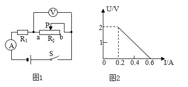

# Physics - 题目 2333

**ID**: c3177f9d0eca44b1908fc63ca9001277
**年级**: Grade 9
**难度**: Medium
**题型**: Multiple-select

## 题目
如图所示的电路中，R_{1}为定值电阻，R_{2}为滑动变阻器，电源电压为3V且保持不变，闭合开关S后，滑片P从b端移动到a端的过程中，电压表示数U与电流表示数I的关系图像如图所示，下列判断正确的是（      ）​​​​​​​‌

## 解答

1. A．由图1可知，两电阻串联，电压表测R_{2}两端的电压，电流表测电路中的电流。当滑动变阻器接入电路中的电阻为0时，电路中的电流最大，由图2可知I_{1}=0.6A，R_{1}的电阻 ${\rm \mathit{R}_{1}=}\frac {U}{I{{}_{1}}}=\frac {3{\rm{V}}}{0.6{\rm{A}}}{\rm =5Ω}$ ，故A正确；
2. C．电路消耗的最大功率P_{1}=UI_{1}=3V×0.6A=1.8W，故C正确；
3. B．当滑动变阻器接入电路中的电阻最大时，电路中的电流最小，由图2可知I_{2}=0.2A，U_{2}=2V，则滑动变阻器的最大阻值 ${\rm \mathit{R}_{2}=}\frac {U{{}_{2}}}{I{{}_{2}}}=\frac {2{\rm{V}}}{0.2{\rm{A}}}{\rm =10Ω}$ ，故B正确；
4. D．电路消耗的最小功率P_{2}=UI_{2}=3V×0.2A=0.6W，故D错误。

## 知识点

**中文**:
  - 与欧姆定律有关的动态电路计算
  - 电功率的计算及应用

**English**:
  - Calculations in Dynamic Circuits using Ohm's Law
  - Calculation and Application of Electric Power

---
