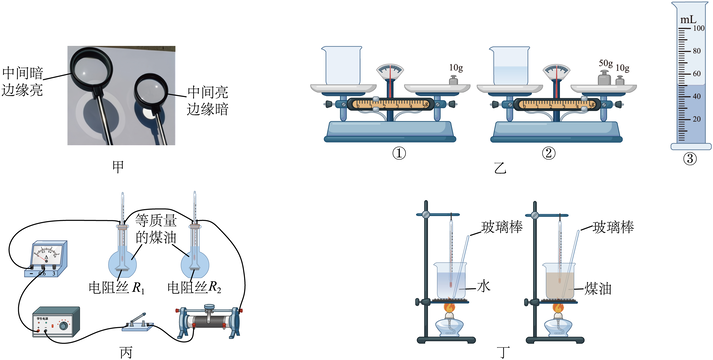

# Physics - 题目 1272

**ID**: c51169a3d6ca43cfa3cd8e612cf9175a
**年级**: Grade 9
**难度**: Medium
**题型**: Multiple-select

## 题目
关于如图所示的四个实验情景中，下列说法中正确的是（      ）​​​​​​​‌

## 解答

1. A．甲图中阳光通过左边镜片形成的光斑中间较四周暗，对光线起发散作用，因此是凹透镜，凹透镜可以矫正近视眼，阳光通过右边镜片形成的光斑中间较亮，对光线起会聚作用，因此是凸透镜，故A错误；
2. B．当将烧杯中的盐水全部倒入量筒中时，并不能倒干净，所以体积测量值偏小，根据密度公式可知所测密度偏大，故B正确；
3. C．丙图中两电阻串联，通过两电阻的电流和通电时间相等，而电阻阻值不同，故可探究电流产热与电阻关系，以其中任一电阻为研究对象（电阻不变），通过移动变阻器的滑片可改变通过电阻的电流大小，故可探究电流产热与电流的关系，故C正确；
4. D．在做“探究物质吸热能力”的实验时，根据控制变量法，要选用质量相同的水和煤油来进行实验，故D错误。

## 知识点

**中文**:
  - 影响电流热效应因素的探究实验
  - 辨别凸透镜和凹透镜
  - 液体密度的测量实验
  - 物质的比热容探究实验

**English**:
  - Experiment: Factors Affecting Heating Effect
  - Distinguishing Convex and Concave Lenses
  - Experiment: Measuring Density of Liquids
  - Experiment: Investigating Specific Heat Capacity

---
