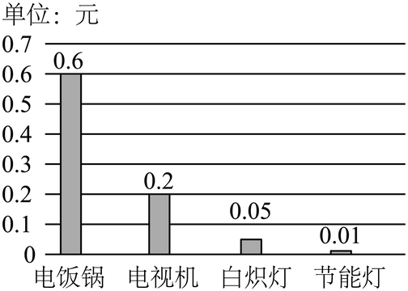

# Physics - 题目 2581

**ID**: cb6245243e98486c82b30a49ed7e4cd4
**年级**: Grade 9
**难度**: Medium
**题型**: Multiple-select

## 题目
学习了电学知识后，小明按照当地的计费标准，将节能灯，白炽灯，电视机和电饭锅四个家用电器正常工作1h所用的电费给制成了柱状图，如图所示。​​​​​​​‌下列说法正确的是（      ）

## 解答

1. A．由图可知，电饭锅正常工作1h所用的电费大于电视机正常工作1h所用的电费，说明工作时间相同，电饭锅消耗的电能多，根据W=Pt可知，电饭锅正常工作时的电功率大于电视机正常工作时的电功率，故A正确；
2. BC．由图可知，四个家用电器正常工作时，电饭锅正常工作1h所用的电费最多，说明工作时间相同，电饭锅消耗的电能最多，根据W=Pt可知，电饭锅的电功率最大，我国家庭电路的电压均为220V，即四个家用电器正常工作时的电压相等，根据P=UI可知，电饭锅内部电路中的总电流最大，故B正确，C错误。
3. D．若电饭锅和电视机的使用时间相同，则每月使用电饭锅用的电费比使用电视机的电费多，但实际生活中，每月使用电饭锅的时间不一定等于使用电视机的时间，所以每月使用电饭锅用的电费不一定比使用电视机用的电费多，故D错误。

## 知识点

**中文**:
  - 电功与电能的计算
  - 电功率的计算及应用

**English**:
  - Calculation of Electric Work and Energy
  - Calculation and Application of Electric Power

---
