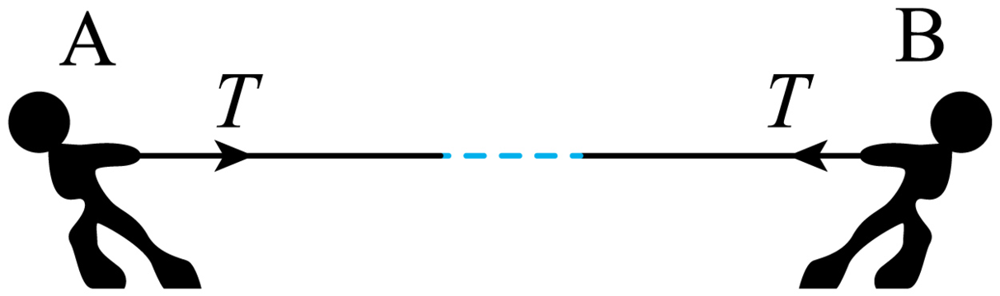
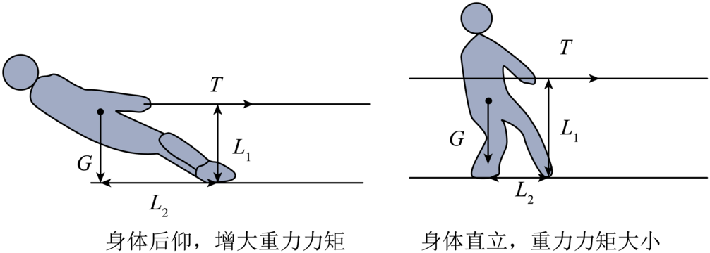

# Physics - 题目 2536

**ID**: 1649c3cb5ca54d8fbb13b4f1a4a2f96f
**年级**: Grade 9
**难度**: Medium
**题型**: Science Reading

## 题目
请阅读《拔河》回答。​​​​​​​‌拔河，即双方各执绳的一端进行角力的体育活动，属于中国的传统运动项目。拔河是一项团体运动，其团结合作的重要性不言而喻。作用在同一个物体上的多个分力，当力的方向相同且在同一条直线上时合力最大。因此所有队员拔河时绳子必须是一条直线，尽量使每个人的力都在一个方向上，如此才能产生最大的合力。如图所示，双方对绳有拉力，同时受到绳对双方的拉力。根据相互作用力知识，A方对绳的拉力与绳对A方的拉力相等，B方对绳的拉力与绳对B方的拉力相等，当一根绳静止或缓慢移动时，绳上的拉力处处相等，由此可知双方对绳的拉力大小相等均等于绳的张力 $T$ 且方向相反。拔河时被拉动的一方是失败的，简单来说，拔河输掉比赛的情况有两种：情况1：两个队伍在拉扯时，运动员与地面之间的摩擦力会影响绳子的运动，如果输的一方人的姿势不变，原封不动的被拉了过来，这种情况主要是输在了最大静摩擦力。最大静摩擦力是指拉动物体，当物体即将滑动而未滑动时受到的摩擦力，即临界状态的最大摩擦力。要想增大这个摩擦力，可以通过增大与地面的正压力，比如选择体重较大的队员，或者通过增大人与地面的摩擦系数，如穿着具有良好摩擦性能的运动鞋。情况2：在拔河时，运动员的身体相当于杠杆，如果输的一方被拉得“转动起来”，即身体前倾后向前扑倒，最后脚底不稳输掉比赛，这种情况主要是输在了重力的力矩上。如图所示，专业的拔河比赛运动员，拔河时身体后倾的非常夸张。其目的就是为了增大重力的力矩。所谓力矩，即力和力臂的乘积。拔河比赛为什么跟力矩有关系呢？如图所示。把人看作一个杠杆，人后仰时，绳子作用在人身上的力让人以脚底为支点向前旋转，即前倾，阻碍人发生转动的力是人的重力，身体后倾角度越大，重力的力臂 $L{{}_{2}}$ 越大，从而增大了力矩 $G\cdot L{{}_{2}}$ ，同时也减小了绳子拉力的力矩 $T\cdot L{{}_{1}}$ 。综上，保证脚底不打滑的同时增大重力力矩，拔河比赛中想把人拉动或拉得前倾绝非易事。请根据上述材料，回答下列问题：（1）拔河比赛时，获胜和输掉的双方对绳子的拉力的大小（选填“相等”或“不相等”）；（2）拔河比赛时，应选择体重较（选填“轻”或“重”）的运动员参加比赛；（3）根据杠杆平衡知识，被拉得前倾输掉比赛的一方，其重力力矩与绳子拉力的力矩的关系是， $G\cdot L{{}_{2}}$$T\cdot L{{}_{1}}$ （选填“ $>$ ”“ $<$ ”或“ $=$ ”）；（4）如图所示，请写出拔河比赛中的任意一对平衡力：。

## 解答

1. （1）拔河时，绳子缓慢移动，绳上的拉力处处相等，双方对绳的拉力大小相等均等于绳的张力 $T$ 且方向相反。
2. （2）通过增大与地面的正压力，增大摩擦力，所以选择体重较大的队员；在人身高和后仰程度相同的情况下，增大重力能增大重力的力矩，同样应选择体重较大的队员。
3. （3）在拔河时，运动员的身体相当于杠杆，当一方的重力力矩小于绳子拉力的力矩，这一方队员就被拉得“转动起来”，从而输掉比赛。
4. （4）由图可知：绳子对人的拉力和地面对人的摩擦力不在同一直线上，所以不是平衡力。图中人受到的重力和地面对人的支持力在同一直线上，方向相反，且人在竖直方向上保持静止，所以图中人受的重力与地面对人的支持力是一对平衡力。

## 知识点

**中文**:
  - 二力平衡的概念及平衡状态的判断
  - 增大或减小摩擦的方法
  - 杠杆平衡条件的应用

**English**:
  - Concept and Judgment of Equilibrium
  - Methods to Increase or Decrease Friction
  - Application of Lever Equilibrium Conditions

---
