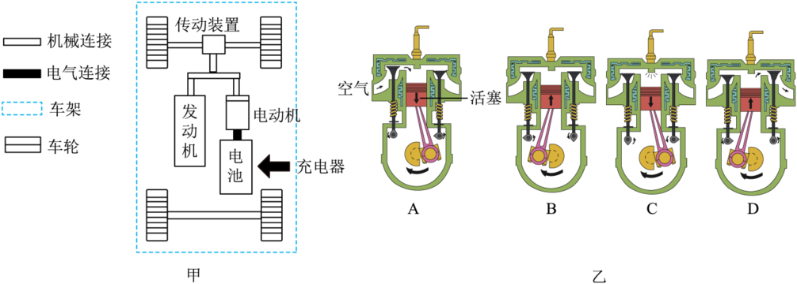

# Physics - 题目 1542

**ID**: 54deda26b1e442ff91e729a4c240756c
**年级**: Grade 9
**难度**: Medium
**题型**: Science Reading

## 题目
阅读短文，回答问题：2024年5月28日，比亚迪第五代DM技术发布暨秦LDM-i、海豹06DM-i发布会在陕西西安举行。​​​​​​​‌作为插电式混合动力的研发成果，比亚迪第五代DM技术可实现最高发动机热效率高达46%、最低百公里亏电油耗3L和最长综合续航2100公里，这些数据在全球汽车市场首屈一指。DMI5.0是比亚迪最新一代的双模混合动力技术，该动力系统的汽车，在电池电量充足的情况下，电池为电动机供电。当电池电量不足时，系统便启动发动机带动发电机对电池进行充电。为节约能源，该混合动力汽车采用再生制动器，开启时它把汽车刹车制动时消耗的一一部分动能转化为电能储存在蓄电池中，同时产生汽车所需的制动力，从而有效减少了汽车的燃油消耗和制动器摩擦片的磨损。储能效率是指汽车正常行驶时关闭发动机，开启再生制动器，直至汽车停止的过程中，通过发电机将动能转化为电能的效率。其驱动原理如图甲所示：行驶动力可由电动机或发动机单独提供，也可以由二者同时提供。（1）当电池电量充足时，该汽车行驶时通过电池使电动机转动，从而驱动汽车行驶。此过程中电能转化为能；（2）当电池电量不足时，插电式混动汽车动力由发动机提供。发动机是内燃机，通过燃油燃烧产生高压气体推动活塞做功，图乙中发动机产生动力的冲程的是（填“A”、“B”、“C”、“D”）；（3）汽车上坡时，将挡位切换为低速挡，以减小行驶的速度，这样做的目的是；

## 解答

1. （1）汽车行驶时通过电池使电动机转动，消耗电能，从而驱动汽车行驶，产生机械能，此过程中能量的转化形式为：电能主要转化为机械能。
2. （2）当电池电量不足时，插电式混动汽车动力由发动机提供。发动机是内燃机，通过燃油燃烧产生高压气体推动活塞做功，是做功冲程，此时进排气门都必须关闭，其他膨胀做功，活塞下移，故图乙中发动机产生动力的冲程的是C。
3. （3）由 $P=\frac {W}{t}=\frac {Fs}{t}=Fv$ ，可知，汽车的最大功率一定时，减小行驶速度时，可以获得更大的牵引力，故ABC不符合题意，D符合题意。
4. （4）关闭发动机后，关闭再生制动器，汽车克服摩擦力做功，动能全部转化为内能，开启再生制动器，有部分动能转化为电能，克服摩擦力做功的能量减少，摩擦力大小不变，因此汽车运动的距离减小，所以开启再生制动器的图线是②；由图象可以看出正常行驶的情况下，关闭发动机后行驶40m-30m=10m，开启再生制动器行驶的距离为36m-30m=6m，因此动能转化为内能的效率为 $η=\frac {6{\rm{m}}}{10{\rm{m}}}=60\%$ ，所以储能效率η^{′}=1-η=1-60%=40%。
5. （5）汽车消耗汽油的质量m_{汽油}=ρ_{汽油}V=0.8×10^{3}kg/m^{3}×3×10^{-3}m^{3}=2.4kg，汽油完全燃烧放出的热量Q_{放}=m_{汽油}q=2.4kg×5×10^{7}J/kg=1.2×10^{8}J，汽油机输出的有用能量W_{有用}=Q_{放}η=1.2×10^{8}J×46%=5.52×10^{7}J，汽车所受阻力为400N，汽车做匀速直线运动，则牵引力F=f=400N，汽车克服阻力所做的功为W=Fs=400N×100×10^{3}m=4×10^{7}J，则最终蓄电池增加的能量W_{电}=W_{有用}-W_{机械}=5.52×10^{7}J-4×10^{7}J=1.52×10^{7}J。

## 知识点

**中文**:
  - 内燃机的四个冲程
  - 功率的计算和估算
  - 热值及相关计算
  - 有关热机效率的计算
  - 能量的转化

**English**:
  - Four Strokes of Internal Combustion Engines
  - Calculation and Estimation of Power
  - Calorific Value and Calculations
  - Calculations of Heat Engine Efficiency
  - Transformation of Energy

---
