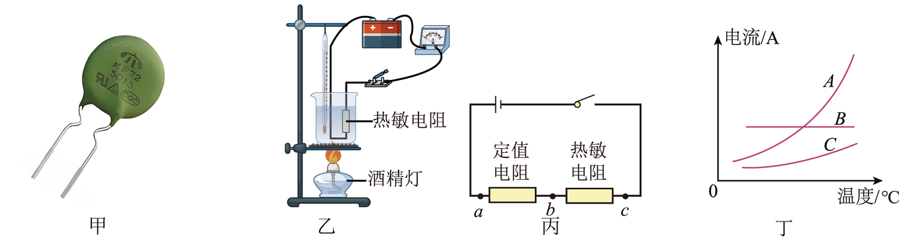

# Physics - 题目 1863

**ID**: f586d3d3a8e84a88865fe9bb3823c635
**年级**: Grade 9
**难度**: Medium
**题型**: Science Reading

## 题目
阅读材料，回答问题热敏电阻热敏电阻的阻值会随着温度的变化而变化，甲图是热敏电阻的实物图，物理兴趣小组的同学在学习《电阻》时发现，有的电阻会随温度、压力等外界因素的改变而发生变化。​​​​​​​‌那么热敏电阻的阻值大小与温度有什么关系呢?为此他们在实验室找来如图甲所示的热敏电阻进行探究：（1）同学们组装了如图乙所示的装置进行实验，实验中通过反映电阻的大小；为了使现象更明显，烧杯中的液体应该选择（选填“水”或“煤油”）；（2）点燃酒精灯，闭合开关进行实验，电源电压不变，记录的数据如下表所示。分析实验数据可知该热敏电阻的阻值随温度升高而（选填“增大”或“减小”）；温度t/℃10203040506070电流I/A0.130.160.210.270.340.430.55（3）用这个热敏电阻和一个电压表改装成了一个指针式温度计，设计的电路如图丙所示，若要使电压表示数随温度升高而增大，则应将电压表并联在（选填“ab”“bc”或“ac”）两端；（4）小华将A、B、C三个电阻替换烧杯内的热敏电阻，分别接入如图乙所示的电路中，获得了图丁所示三个电阻的“温度与电流”图像，其中对温度变化反应最灵敏的电阻是（选填“A”“B”或“C”）。

## 解答

1. （1）根据转换法，实验中通过电流表示数大小来反映电阻的大小的；实验中，液体吸收相同的热量时，液体的温差变化较大，热敏电阻阻值变化较大，电流表示数变化明显，吸收相同的热量温度变化量大的比热容小，故实验中应该选用比热容较小的煤油。
2. （2）根据表格中的数据可知，温度升高时，通过热敏电阻的电流变大，电源电压不变，故热敏电阻的阻值变小，所以热敏电阻的阻值随温度升高而减小。
3. （3）由前面分析可知，热敏电阻的阻值随温度的升高而减小，所以温度升高时，电流增大，定值电阻两端的电压变大，热敏电阻两端的电压变小，要使电压表的示数增大，因此电压表应该并联在定值电阻两端，即ab两端。
4. （4）由图丙可知，A、B、C三个电阻中，随着温度的变化通过A电阻的电流变化最明显，故A电阻的灵敏度最高。

## 知识点

**中文**:
  - 导体的电阻受温度的影响
  - 电路的动态分析

**English**:
  - Effect of Temperature on Resistance
  - Dynamic Circuit Analysis

---
