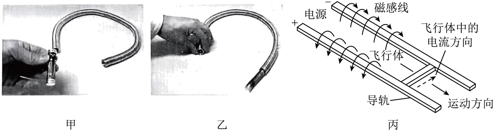

# Physics - 题目 1396

**ID**: fb016246c0e9459f8dfa57f045a099ce
**年级**: Grade 9
**难度**: Medium
**题型**: Science Reading

## 题目
请阅读《最强“弹弓”——电磁发射系统》并回答题。​​​​​​​‌最强“弹弓”——电磁发射系统如图甲所示，分别将两块钕铁硼强磁体（导体）吸在干电池的两极，将该电池从铜线圈的一端放入，会观察到电池从另一端快速“弹出”（如图乙所示）。这是因为电池放入线圈后，其两极所吸的强磁体与线圈接触，使其间的线圈中有较大的电流通过，通电线圈与磁体之间存在相互作用力，将电池“弹出”，电磁发射系统的原理与以上实验的原理相似。电磁发射系统适宜短行程发射大载荷，在军事、民用和工业领域具有广泛的应用前景。如图丙所示是一种电磁发射系统的基本原理，当电流通过飞行体时，飞行体会在磁场中受力而向前飞出，进而带动与之连接的载荷高速飞出。通过调节电流的大小，可以方便地控制发射的力度和速度，从而实现对各类型载荷的有效弹射。电磁发射系统中的技术难关之一是解决轨道烧蚀问题，如某次电磁发射实验中，在发射的时候有几十万安培的电流会经铜导轨从飞行体的一端流入另一端，这时飞行体受力向前运动，最终以几千米每秒的速度飞出。实验后观察到电流在导轨上形成了长度大于一厘米的烧蚀坑，严重影响后续的使用。因此，电磁发射系统的导轨必须能承受强大的电流，发射过程中复杂的机械、电气和热作用及强大的侧向力，对导轨材料的耐瞬间高温、高硬度等特性提出了极为苛刻的要求。请根据上述材料，回答下列问题：（1）以下应用中，与电磁发射过程的能量转化相同的是（选填选项前的字母，正确选项只有一个）；A．发电机B．电动机C．汽油机（2）导轨的材料应具有的特性是（选填选项前的字母，正确选项多于一个）；A．导电性弱B．耐高温C．硬度大（3）“电流在导轨上形成了长度大于一厘米的烧蚀坑”，请写出这一过程中，电流产生巨大热量的依据；（4）小明尝试模拟电磁发射系统，他将待发射的金属棒放置在磁场中的两平行铜导轨上，给导轨通电，就有电流通过金属棒，使金属棒在磁场中受力而弹出。如果要增大金属棒弹出的速度，可行的方案是（写出一条即可）。

## 解答

1. （1）A．电磁发射过程将电能转化为机械能，发电机是将机械能转化为电能，故A不符合题意；
2. B．电动机是将电能转化为机械能，故B符合题意；
3. C．汽油机是将内能转化为机械能，故C不符合题意。
4. （2）电磁发射系统的导轨必须能承受强大的电流，发射过程中复杂的机械、电气和热作用及强大的侧向力，故需要其导电性能好、耐高温、硬度高等，故A不符合题意，BC符合题意。
5. 故选BC。
6. （3）由Q＝I^{2}Rt知，当R和t一定时，电流越大，产生的热量越多。
7. （4）通电金属棒受力大小与电流大小有关，故可以通过适当增大电流来增大金属棒弹出的速度。

## 知识点

**中文**:
  - 焦耳定律的计算公式及其应用
  - 物质的物理属性
  - 磁场对通电导线的作用
  - 电动机的能量转化

**English**:
  - Formula and Application of Joule's Law
  - Physical Properties of Matter
  - Effect of Magnetic Field on Energized Wire
  - Energy Transformation in Motors

---
