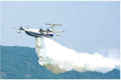

# Physics - 题目 1385

**ID**: 67ace44d068c4ee2852a42ae3fccda6b
**年级**: Grade 9
**难度**: Medium
**题型**: Short Answer

## 题目
如图所示是我国自行设计研制的大型水陆两栖飞机“鲲龙”AG600演练喷水救火的情景。​​​​​​​‌请你回答：（1）飞机匀速飞行且喷水救火过程中，动能怎样变化？（2）飞机机翼为什么设计成上表面弯曲，下表面较平的上下不对称的形状？

## 解答

1. （2）飞机机翼上方是凸形的，下方是平的，相同时间内，空气通过上方的路程大，通过上方的速度更大，通过下方的路程小，通过下方的速度更小，根据流体流速与压强的关系可知，流体流速越大，压强越小，则飞机机翼上方的压强小，下方压强大，机翼受到压强差的作用，受到压力差的作用，产生向上的升力作用。

## 知识点

**中文**:
  - 动能的变化问题
  - 流体压强与流速的关系

**English**:
  - Changes in Kinetic Energy
  - Relationship between Fluid Pressure and Flow Speed

---
